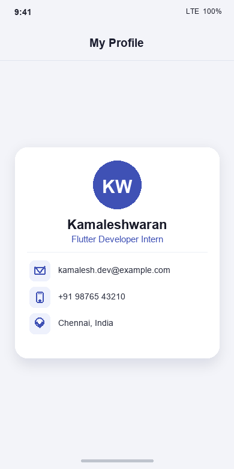

# Profile Card App - Flutter (Project 01)

A single-screen Flutter application displaying a responsive, beautifully styled profile card with an avatar, name, role, and contact rows.

Built according to the **InternCircle Project 01: Profile Card App** specification.

---

## 📱 Project Preview



---

## 📋 Project Checklist & Requirements

| Requirement | Implementation | Status |
| :--- | :--- | :---: |
| **App Skeleton** | `runApp` with `MaterialApp` and `Scaffold` | ✅ Complete |
| **Material 3 Theme** | `ThemeData(colorSchemeSeed: Colors.indigo, useMaterial3: true)` | ✅ Complete |
| **Centered Card Layout** | `Center` + `ConstrainedBox(maxWidth: 360)` + `Card` | ✅ Complete |
| **Circular Avatar** | `CircleAvatar` with initials and theme background | ✅ Complete |
| **Name & Role Styling** | `Text` widgets with distinct `TextStyle` sizes and weights | ✅ Complete |
| **Contact Rows with Icons** | Three contact rows (Email, Phone, Location) | ✅ Complete |
| **Reusable Widget** | Refactored `ContactRow` as an independent `StatelessWidget` | ✅ Complete |
| **Narrow Screen Support** | Responsive card bounded to 360px max width | ✅ Complete |
| **Const Optimization** | Applied `const` constructors wherever possible | ✅ Complete |

---

## 📝 Required Submission Details

### 1. What is a Widget?
> **"In Flutter, a widget is an immutable description of a part of a user interface, serving as the fundamental building block that defines how a view looks, its structure, and its layout through a nested widget tree."**

### 2. DartPad Execution Instructions
1. Open [dartpad.dev](https://dartpad.dev)
2. Select **New** &rarr; **Flutter**
3. Replace the entire code with the contents of [`lib/main.dart`](lib/main.dart)
4. Click **Run** to see the live profile card.

---

## 💻 Full Flutter Source Code

```dart
import 'package:flutter/material.dart';

/// Entry point of the Flutter application.
void main() {
  runApp(const ProfileApp());
}

/// Root widget of the application configuring Material 3 theme and navigation.
class ProfileApp extends StatelessWidget {
  const ProfileApp({super.key});

  @override
  Widget build(BuildContext context) {
    return MaterialApp(
      title: 'Profile Card',
      debugShowCheckedModeBanner: false,
      theme: ThemeData(
        colorSchemeSeed: Colors.indigo,
        useMaterial3: true,
        scaffoldBackgroundColor: const Color(0xFFF4F6FB),
      ),
      home: Scaffold(
        appBar: AppBar(
          title: const Text(
            'My Profile',
            style: TextStyle(fontWeight: FontWeight.bold),
          ),
          centerTitle: true,
          elevation: 0,
        ),
        body: const Center(
          child: SingleChildScrollView(
            child: ConstrainedBox(
              constraints: BoxConstraints(maxWidth: 360),
              child: ProfileCard(),
            ),
          ),
        ),
      ),
    );
  }
}

/// The main card component displaying user information.
class ProfileCard extends StatelessWidget {
  const ProfileCard({super.key});

  @override
  Widget build(BuildContext context) {
    final theme = Theme.of(context);

    return Card(
      elevation: 3,
      shape: RoundedRectangleBorder(
        borderRadius: BorderRadius.circular(20),
      ),
      margin: const EdgeInsets.symmetric(horizontal: 16, vertical: 24),
      child: Padding(
        padding: const EdgeInsets.symmetric(horizontal: 24, vertical: 28),
        child: Column(
          mainAxisSize: MainAxisSize.min,
          crossAxisAlignment: CrossAxisAlignment.center,
          children: [
            // Circular avatar with initials
            CircleAvatar(
              radius: 40,
              backgroundColor: theme.colorScheme.primary,
              child: Text(
                'KW',
                style: TextStyle(
                  fontSize: 26,
                  fontWeight: FontWeight.bold,
                  color: theme.colorScheme.onPrimary,
                  letterSpacing: 1.5,
                ),
              ),
            ),
            const SizedBox(height: 16),

            // User Name
            Text(
              'Kamaleshwaran',
              style: theme.textTheme.headlineSmall?.copyWith(
                    fontWeight: FontWeight.bold,
                    color: Colors.black87,
                  ) ??
                  const TextStyle(
                    fontSize: 22,
                    fontWeight: FontWeight.bold,
                    color: Colors.black87,
                  ),
            ),
            const SizedBox(height: 6),

            // Role / Designation
            Text(
              'Flutter Developer Intern',
              style: TextStyle(
                fontSize: 15,
                fontWeight: FontWeight.w600,
                color: theme.colorScheme.primary,
              ),
            ),
            const SizedBox(height: 20),

            // Subtle Divider
            const Divider(thickness: 1, height: 1),
            const SizedBox(height: 16),

            // Contact details list using reusable ContactRow
            const ContactRow(
              icon: Icons.email_outlined,
              text: 'kamalesh.dev@example.com',
            ),
            const ContactRow(
              icon: Icons.phone_outlined,
              text: '+91 98765 43210',
            ),
            const ContactRow(
              icon: Icons.location_on_outlined,
              text: 'Chennai, India',
            ),
          ],
        ),
      ),
    );
  }
}

/// A reusable widget representing a single contact detail row with an icon and text.
class ContactRow extends StatelessWidget {
  final IconData icon;
  final String text;

  const ContactRow({
    super.key,
    required this.icon,
    required this.text,
  });

  @override
  Widget build(BuildContext context) {
    final theme = Theme.of(context);

    return Padding(
      padding: const EdgeInsets.symmetric(vertical: 6),
      child: Row(
        children: [
          Container(
            padding: const EdgeInsets.all(8),
            decoration: BoxDecoration(
              color: theme.colorScheme.primaryContainer.withOpacity(0.5),
              borderRadius: BorderRadius.circular(10),
            ),
            child: Icon(
              icon,
              size: 20,
              color: theme.colorScheme.primary,
            ),
          ),
          const SizedBox(width: 14),
          Expanded(
            child: Text(
              text,
              style: const TextStyle(
                fontSize: 14,
                color: Colors.black87,
                fontWeight: FontWeight.w500,
              ),
              overflow: TextOverflow.ellipsis,
            ),
          ),
        ],
      ),
    );
  }
}
```
